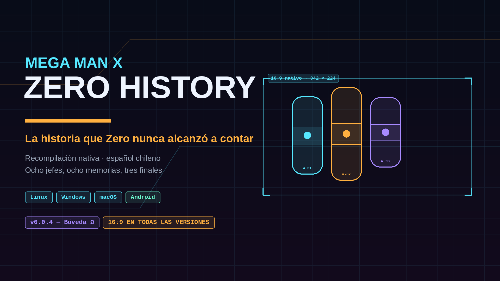
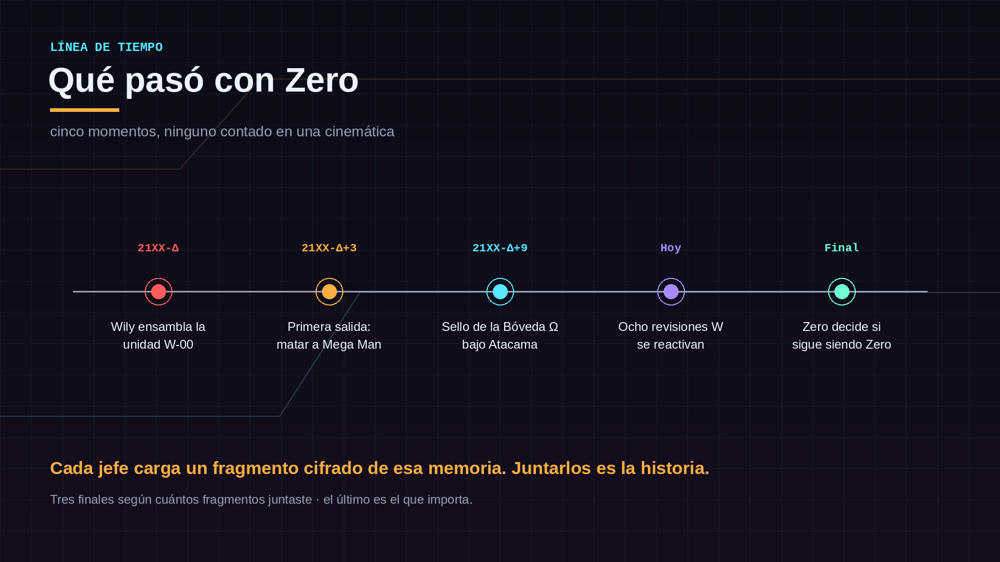
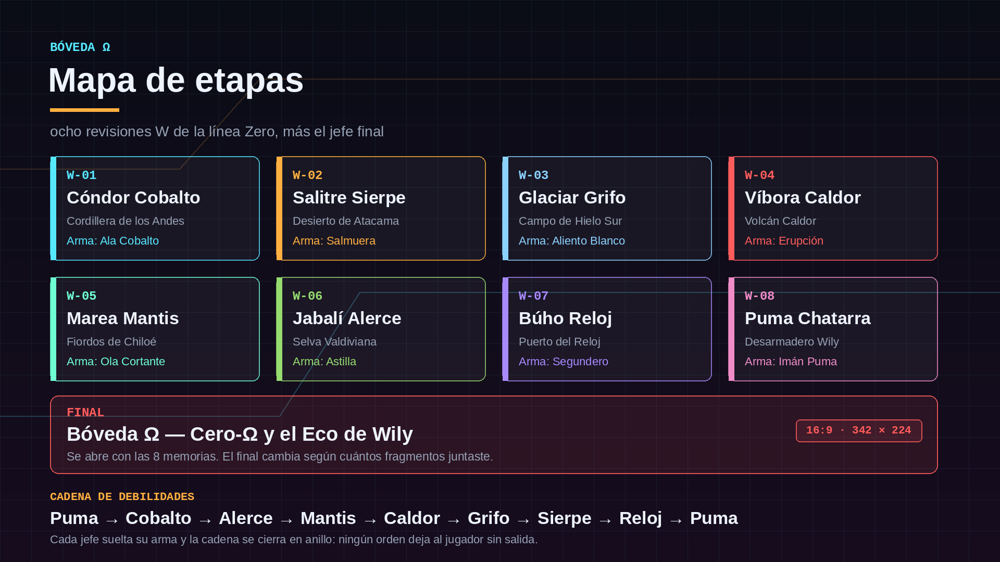
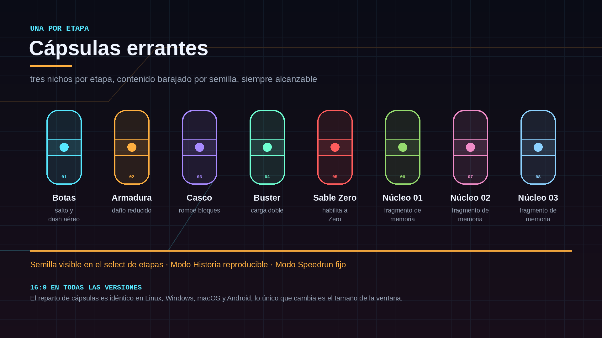
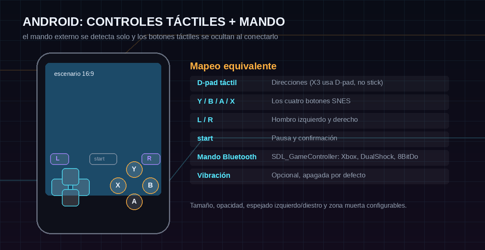
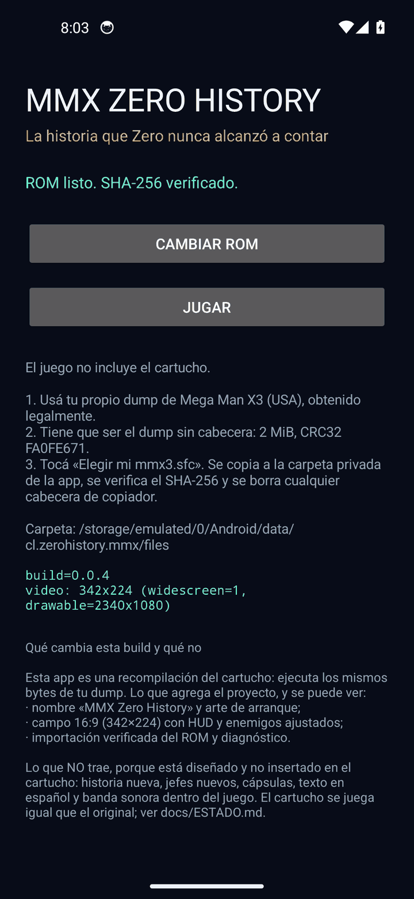

# MMX Zero History

Recompilación nativa de **Mega Man X3 (USA)** con identidad, historia, jefes,
cápsulas y banda sonora propias, en **español chileno**, para Linux, Windows,
macOS y Android.

> La historia que Zero nunca alcanzó a contar.

[](https://github.com/DanimanX/MMX-Zero-History/actions/workflows/build.yml)

## Qué es esto

Un fork de [MegamanX3SNESRecomp](https://github.com/mstan/MegamanX3SNESRecomp)
que conserva el motor (ejecución LLE del 65816 con cobertura AOT encima, Cx4
emulado por instrucción) y le cambia todo lo que se puede cambiar sin tocar el
cartucho: nombre, identidad visual, línea narrativa, guion, diseño de jefes y
cápsulas, banda sonora original, controles táctiles y CI multiplataforma.

## Qué **no** es esto

**No es un ROM hack.** No trae sprites nuevos de jefes, mapas nuevos, música
insertada en el SPC ni el texto del juego traducido dentro del cartucho. Eso es
un proyecto de meses y está especificado, no implementado.

Lo que hay acá es todo el andamiaje alrededor de eso más el motor real
compilando. La línea exacta entre "funciona" y "está escrito" está en
[`docs/ESTADO.md`](docs/ESTADO.md), sin adornos.

### Qué ves cuando jugás

Esto es lo que cambia de verdad al abrir el juego, y es todo:

- **El nombre**: la app es *MMX Zero History*, con icono y placa de arranque
  propios.
- **El campo 16:9** (342×224): HUD anclado a los lados, columnas nuevas de BG1
  y BG2, ventanas de activación y dibujo de enemigos ensanchadas. Se apaga
  desde `config.ini` (`Widescreen = 0`).
- **El diagnóstico**: la pantalla de entrada de Android muestra la versión de
  la build y el campo que el motor eligió, leídos de `native.log`.

Y esto es lo que **no** cambia, porque está diseñado y no insertado: la
historia de la Bóveda Ω, los ocho mavericks, las cápsulas errantes, el guion en
chileno y la banda sonora **no están dentro del juego**. Si abrís el APK y ves
la intro, el select de etapas y los jefes originales de Mega Man X3, es el
comportamiento esperado de esta versión, no un fallo de instalación.

El motor fijado trae un sistema de parches de texto/VRAM en tiempo de
ejecución (`snes_text_xlate`, en `snesrecomp/runner/src`) que este proyecto
**todavía no usa**: es la vía para traducir el guion sin tocar el cartucho, y
necesita las tablas de glifos y las direcciones reales del ROM. Está anotado
como el siguiente trabajo grande en [`docs/ESTADO.md`](docs/ESTADO.md).

## El ROM

Tenés que poner tu propio dump, legalmente obtenido. Nada derivado del ROM se
versiona en este repositorio.

- **archivo**: `mmx3.sfc` en la raíz del repo
- **tamaño**: 2 MiB, sin cabecera
- **CRC32**: `0xFA0FE671`
- **SHA-256**: `65b03268afac296330e8ff8d60dd0825879e13ed658b37713c034a3bd074f1d7`

Una cabecera de copiador SMC de 512 bytes se descarta automáticamente, tanto
en el recompilador como en el launcher. Verificalo con:

```bash
python3 tools/verify_rom.py mmx3.sfc
```

## La historia

Años después de Doppler, una excavación bajo Atacama abre la **Bóveda Ω**: el
archivo personal del Dr. Wily, todavía en línea. Adentro no hay un robot, hay
un **eco** — la voz y el criterio de Wily, grabados para seguir dando órdenes
después de muerto. Y lo que el eco quiere no es conquistar el mundo: es
terminar un trabajo que quedó a medias y recuperar a Zero.

Para eso reactiva ocho revisiones de la unidad **W-00**, el nombre de fábrica
de Zero. Cada jefe carga un fragmento cifrado de su pasado. X baja a las ocho
zonas y, por cada jefe que cae, una memoria vuelve a su lugar.

La historia no se cuenta en una cinemática: se cuenta en pedazos, y el pedazo
que importa es el último — **Wily construyó a Zero para matar a Mega Man**, y
Zero alcanzó a intentarlo.



- Biblia narrativa completa: [`docs/HISTORIA.md`](docs/HISTORIA.md)
- Guion de todas las cinemáticas, en chileno: [`docs/GUION.md`](docs/GUION.md)
- Tres finales según cuántos fragmentos juntaste

## Los ocho mavericks

Ocho revisiones W más el jefe final, con anillo de debilidades cerrado: ningún
orden de etapas deja al jugador sin respuesta.

- **W-01 — Cóndor Cobalto**, Cordillera de los Andes · *Ala Cobalto*
- **W-02 — Salitre Sierpe**, Desierto de Atacama · *Salmuera*
- **W-03 — Glaciar Grifo**, Campo de Hielo Sur · *Aliento Blanco*
- **W-04 — Víbora Caldor**, Volcán Caldor · *Erupción*
- **W-05 — Marea Mantis**, Fiordos de Chiloé · *Ola Cortante*
- **W-06 — Jabalí Alerce**, Selva Valdiviana · *Astilla*
- **W-07 — Búho Reloj**, Puerto del Reloj · *Segundero*
- **W-08 — Puma Chatarra**, Desarmadero Wily · *Imán Puma*
- **Ω — Cero-Ω y el Eco de Wily**, Bóveda Ω



Patrones de ataque, fases y drops en [`docs/MAVERICKS.md`](docs/MAVERICKS.md).

## 16:9 en todas las versiones

Desde la 0.0.2 el campo de juego es 16:9 en Linux, Windows, macOS y Android.
El motor renderiza 342×224 píxeles reales —el máximo que cabe con la relación
de píxel 7:6 de SNES— y rellena las columnas nuevas con los tiles auténticos
de BG1 y BG2; el HUD del jugador se ancla a la izquierda y el del jefe a la
derecha. El paquete `megaman-x3.enhancement.widescreen` viene **habilitado por
defecto** y se puede apagar desde el launcher (Mods → Widescreen).

Los assets, la placa de arranque y el icono se rediseñaron en 16:9
(1920×1080). En Android el modo es inmersivo de borde a borde, con
`layoutInDisplayCutoutMode = shortEdges`; en pantallas 19.5:9 o 20:9 la imagen
sigue siendo 16:9 centrada, no estirada, y los controles táctiles se miden en
unidades del lado corto para seguir cuadrados en cualquier relación de aspecto.

El campo se topa en 342 px (`tools/test_display_width.sh`): es la
configuración que el port midió, así que una pantalla más ancha que 16:9
agrega barras en vez de inventar columnas sin validar.

## Cápsulas errantes

Ninguna cápsula tiene posición fija. Cada etapa tiene **tres nichos**
autorados, todos alcanzables con el equipo base; cada partida elige uno por
etapa y reparte los ocho contenidos al azar.



El reparto es determinista y verificable — publicado como semilla en el select
de etapas:

```console
$ python3 tools/capsule_shuffle.py --mode speedrun
semilla 00000000
  W-01 condor_cobalto   nicho 3  -> Casco      (rompe bloques)
  W-02 salitre_sierpe   nicho 2  -> Núcleo 01  (fragmento de memoria)
  W-03 glaciar_grifo    nicho 1  -> Núcleo 02  (fragmento de memoria)
  ...

$ python3 tools/capsule_shuffle.py --mode historia --slot 1
semilla CC0D3F32
  ...
```

Modos: **Historia** (semilla por perfil/slot/partida), **Speedrun** (semilla
fija `0`) y **Caos** (semilla nueva cada vez). Contrato completo en
[`docs/CAPSULAS.md`](docs/CAPSULAS.md); pruebas con
`python3 tools/test_capsule_shuffle.py`.

## Música

Doce pistas originales a 32 kHz mono, generadas desde código: el tema de la
Bóveda, el select de etapas, las ocho etapas, la Bóveda Ω y el tema de Zero.
Misma familia de timbres que un juego de SNES (dos pulsos, triángulo, ruido),
melodías y progresiones nuevas.

```console
python3 tools/make_soundtrack.py          # renderiza las doce
python3 tools/make_soundtrack.py --list   # tempo, compás y mood
```

Escuchalas en [`assets/audio/`](assets/audio). Diseño y camino de integración
al motor en [`docs/MUSICA.md`](docs/MUSICA.md).

## Plataformas y controles

- **Linux / Windows / macOS** — host de escritorio SDL2, con soporte real de
  mando por `SDL_GameController` (Xbox, DualShock, 8BitDo) y teclado
  remapeable en `keybinds.ini`.
- **Android** — APK arm64-v8a con controles táctiles (D-pad, rombo SNES,
  hombros, start), auto-ocultado al conectar un mando y geometría cuadrada en
  cualquier aspecto.



### APK de Android

Cada release publica `MMXZeroHistory-android-arm64-v8a.apk` (y un build
`x86_64` para emuladores). Es un host LLE sin código derivado del ROM: el
binario no trae el juego, lo carga desde tu dump.

1. Instalá el APK (Android 7.0+).
2. Abrí la app. La primera pantalla pide el cartucho.
3. Tocá **Elegir mi mmx3.sfc** y elegí tu dump con el selector del sistema. Se
   copia a la carpeta de la app, se verifica el SHA-256 y se descarta la
   cabecera de copiador si la trae.
4. La app arranca el motor con el campo 16:9.



Para capturar una pantalla de juego —la etapa 1, por ejemplo— con tu dump ya
cargado:

```console
tools/capture_android.sh docs/img/android-etapa-1.png
```

Desde la 0.0.3 la app **no se cierra al abrir**: si falta el ROM (o no es el
dump correcto) lo dice en pantalla, y si el motor se corta después de arrancar
muestra el final de `native.log` en vez de desaparecer.

El APK se compila, se firma y se ejecuta en un emulador x86_64 del repo
(SDK 34, Android 14): la pantalla de entrada queda estable, el importador
rechaza un archivo con SHA-256 equivocado y el motor llega a
`first frame simulated` con un dump presente. Lo que **no** se pudo verificar
es una partida real: hace falta un dump legal de Mega Man X3 (USA), que este
repositorio no incluye.

La capa táctil se dibuja con geometría 16:9 y produce la máscara de botones,
pero el envío al guest sigue pendiente porque el estado del pad es privado del
host: para jugar hoy hace falta un mando Bluetooth. La receta completa está en
[`docs/ANDROID.md`](docs/ANDROID.md).

La **lógica táctil** sí está probada en el escritorio (17 pruebas: dos dedos a
la vez, dos dedos en el mismo botón, latcheo al deslizar, saturación de la
tabla de dedos, espejado exacto y teclas cuadradas en 16:9, 19.5:9, 20:9 y
4:3):

```console
bash tools/test_touch_controls.sh
bash tools/test_display_width.sh
```

El APK se construye con:

```console
bash tools/build_android.sh arm64-v8a
```

## Build

```bash
git submodule update --init --recursive
cp /ruta/a/tu/dump mmx3.sfc
python3 tools/verify_rom.py mmx3.sfc
bash tools/regen.sh --no-tests          # emite src/gen/*.c + recomp/funcs.h
cmake -S . -B build -G Ninja -DCMAKE_BUILD_TYPE=Release -DSNESRECOMP_SDL_BACKEND=SDL2
cmake --build build --target MegaManX3SNESRecomp
```

Para depurar con el servidor TCP de 4384 y los anillos de observabilidad,
configurá con `-DSNESRECOMP_ENABLE_TRACE=ON`.

Sin ROM se puede compilar igual el *setup host*, que es lo que corre CI:

```bash
cmake -S . -B build -G Ninja -DCMAKE_BUILD_TYPE=Release -DSNESRECOMP_SETUP_HOST=ON
cmake --build build --target MegaManX3SNESRecomp
```

## Integración continua

- **`build.yml`** — pruebas (cápsulas + táctil) y compilación del host de
  escritorio en Linux. Es el gate real.
- **`rom-build.yml`** — **manual**. Compila el binario jugable en Linux,
  Windows y macOS leyendo tu ROM desde el secreto `MMX3_ROM_BASE64`, que nunca
  entra al repositorio. Verifica el SHA-256 antes de aceptar el archivo.
- **`android.yml`** — **manual**. Compila el APK de un ABI concreto con
  `tools/build_android.sh` y lo deja como artefacto. No necesita el ROM.
- **`release.yml`** — al empujar una etiqueta `v*`, publica los paquetes de las
  tres plataformas de escritorio, el **APK de Android**, arte, banda sonora y
  el aviso de ROM.

Estado de cada uno al publicar la 0.0.2:

- **Desktop host (Linux)**: verde — pruebas + compilación, corrida real en CI.
- **Release**: publica los tres `.zip` de escritorio y el APK arm64-v8a, con el
  catálogo de mods incluido para que el 16:9 viaje activo.
- **Android**: `tools/build_android.sh` compiló el APK en esta máquina con SDK
  34 / NDK r27 y lo firmó; el workflow `Android` corre el mismo paso.
- **rom-build**: escrito, nunca corrido (necesita el secreto con tu ROM).

## Estado

Lo que corre hoy, lo que está escrito y lo que no existe (sprites, mapas,
música insertada, traducción dentro del cartucho) está separado explícitamente
en [`docs/ESTADO.md`](docs/ESTADO.md). Si algo de este README suena a que el
juego nuevo ya está adentro del cartucho, leé ese archivo.

## Créditos y licencia

- Motor: [snesrecomp](https://github.com/RetroPortingToolKit/snesrecomp) y
  [recomp-ui](https://github.com/RetroPortingToolKit/recomp-ui), con el port
  original de [mstan](https://github.com/mstan/MegamanX3SNESRecomp).
- Emulación del Cx4: adaptada de [ares](https://github.com/ares-emulator/ares)
  (ISC), vía snesrecomp.
- Anotaciones de desensamblado: [bogaa/dizProjects](https://github.com/bogaa/dizProjects).
- Todo el contenido nuevo de Zero History —historia, guion, diseño, arte,
  banda sonora y código— es original de este repositorio.
- Licencia del código: **PolyForm Noncommercial 1.0.0** (ver [`LICENSE`](LICENSE)).
  El ROM de Mega Man X3 y cualquier dato extraído de él **no** se distribuyen
  acá y no están licenciados para redistribución.

Documentación técnica heredada del port original: [`docs/WIDESCREEN.md`](docs/WIDESCREEN.md),
[`docs/SAVE_STATES.md`](docs/SAVE_STATES.md), [`docs/CX4.md`](docs/CX4.md),
[`docs/COVERAGE_2026-10-18.md`](docs/COVERAGE_2026-10-18.md).
